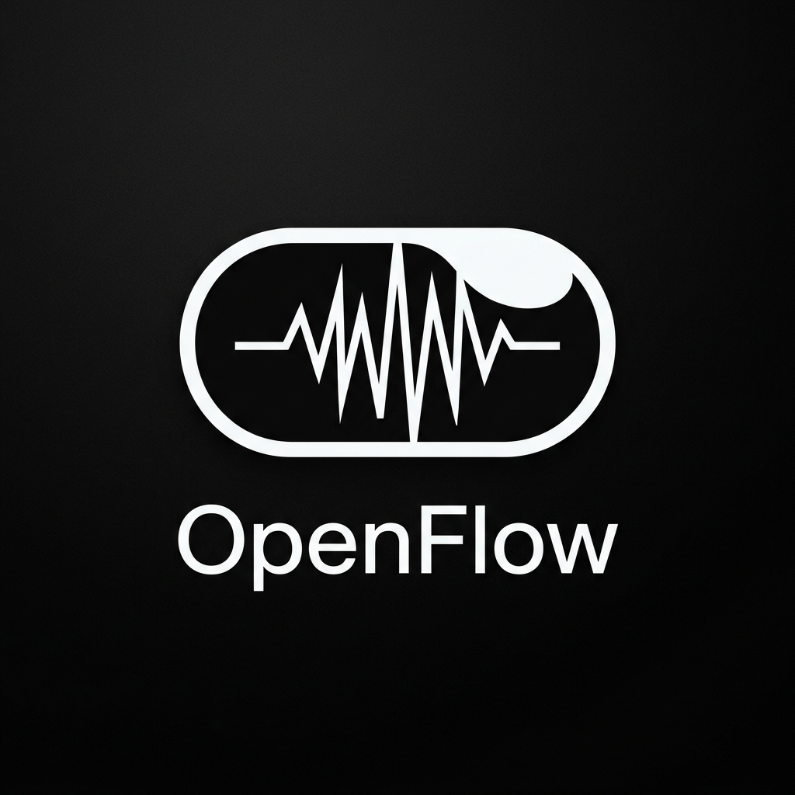
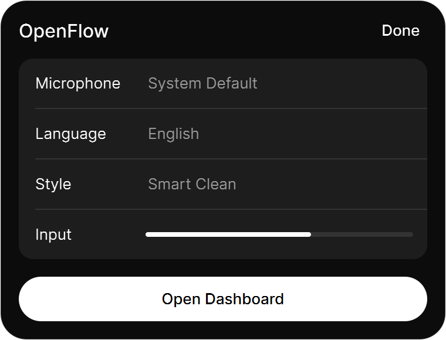
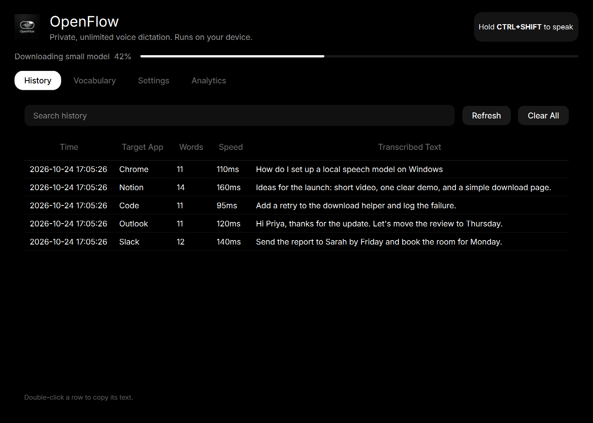
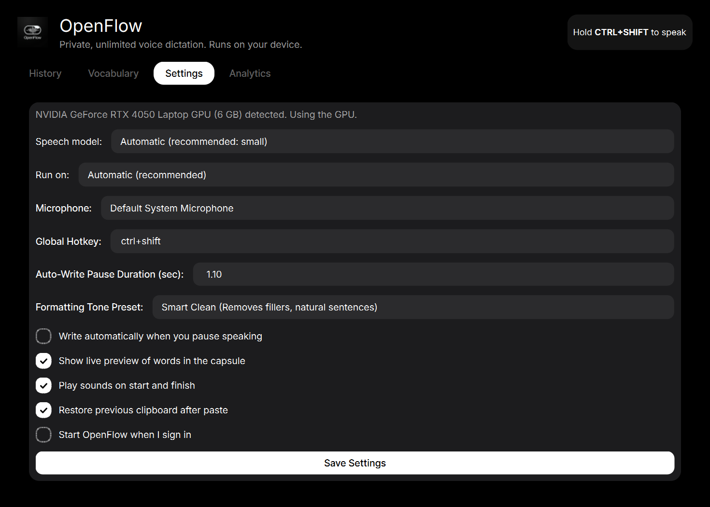
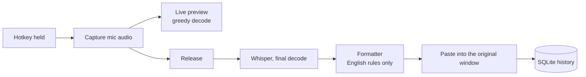

<div align="center">



# OpenFlow

**Speak. It types.**

Free, private, unlimited voice dictation for Windows.<br>
Hold a key, talk, and the words land in any app. Runs offline on your own GPU.

<br>


<br>


[Website](docs/index.html) &nbsp;·&nbsp; [Releases](https://github.com/Sachin1724/OpenFlow/releases) &nbsp;·&nbsp; [Quick start](#quick-start) &nbsp;·&nbsp; [Languages](#languages-and-models) &nbsp;·&nbsp; [Build the exe](#build-the-executable) &nbsp;·&nbsp; [FAQ](#faq)

</div>

<br>

## Why OpenFlow

Paid dictation apps cap your minutes, upload your audio, and charge monthly. OpenFlow does the same job on your own machine.

| | |
| :-- | :-- |
| **Unlimited** | No word counter, no tiers, no account. |
| **Private** | Recording, recognition and formatting all happen locally. After a one-time model download it works with the network off. |
| **Fast** | `faster-whisper` on CUDA transcribes a sentence in roughly 100 to 200 ms. |
| **99 languages** | English uses a fast English-only model; other languages and auto-detect use a multilingual one. |
| **Anywhere** | It pastes into the window you were using when you started speaking, then restores your clipboard. |
| **Quiet** | Lives in the tray, starts at sign-in, frees the GPU after ten idle minutes, recovers after sleep. |

<br>

## The interface

A black-and-white capsule that stays out of the way, and a settings panel it morphs into.

<div align="center">

| Listening | Writing | Pasted |
| :-: | :-: | :-: |
|  |  |  |



</div>

<br>

The dashboard keeps a searchable history of every dictation, a custom vocabulary, and settings.

<div align="center">

| History | Settings |
| :-: | :-: |
|  |  |

</div>

<br>

## Quick start

**Requirements:** Windows 10 or 11, Python 3.10 or newer, a microphone. An NVIDIA GPU is optional but recommended.

```powershell
git clone https://github.com/Sachin1724/OpenFlow.git openflow
cd openflow
pip install -r requirements.txt
cd ..
python -m openflow
```

> The package uses relative imports, so run it from the folder **above** `openflow`.

On first launch a short setup asks for your language and downloads the matching speech model once. It can also register OpenFlow to start when you sign in.

**Dictate:** hold <kbd>Ctrl</kbd> + <kbd>Shift</kbd> in any app, speak, release. The text is pasted where your cursor was.

<br>

## No GPU? Smart detection

On first run OpenFlow inspects your PC and recommends a setup. You can accept it or change it in the setup window and later in **Settings**.

| Your PC | Runs on | Model | What to expect |
| :-- | :-- | :-- | :-- |
| NVIDIA GPU with working CUDA | GPU, float16 | Small or Medium, by video memory | Text appears almost as you let go |
| CPU with 8+ cores and 8 GB+ RAM | CPU, int8 | Base | A short wait after you release the key |
| Older or low-power laptop | CPU, int8 | Tiny | Best for short phrases; lower accuracy |

If an NVIDIA GPU is present but CUDA is not usable, OpenFlow says so and falls back to the CPU. To enable the GPU, install the CUDA libraries once and restart:

```powershell
pip install nvidia-cublas-cu12 nvidia-cudnn-cu12
```

CPU speed depends on your processor and on how long you speak, so treat these as guidelines, not benchmarks.

<br>

## Languages and models

| Language | Model used | Size |
| :-- | :-- | --: |
| English | `<size>.en` (English-only, fastest) | 39 to 769 MB |
| Any other language, or Auto Detect | multilingual `<size>`, at least `small` | about 460 MB for `small` |

`<size>` is the quality you pick in Settings: `tiny`, `base`, `small` or `medium`. Switching language downloads the model in the background and never freezes the capsule.

Formatting styles (Smart Clean, Developer, Email, Bullet Points) are **English-only**. For other languages OpenFlow writes what Whisper heard, applying only your vocabulary replacements.

**Do you need an LLM?** No. Whisper already punctuates in every language it supports. An optional local rewrite model is on the [roadmap](#roadmap), off by default.

<br>

## How it works



| Piece | What it does |
| :-- | :-- |
| `engine/audio_recorder.py` | `sounddevice` stream, level meter, silence detection |
| `engine/hardware.py` | GPU, CPU and RAM detection; recommends device and model |
| `engine/model_manager.py` | Model download with live progress |
| `engine/transcriber.py` | `faster-whisper`, language-aware model choice, lazy load and idle unload |
| `engine/formatter.py` | Filler removal, tone presets, custom vocabulary |
| `engine/injector.py` | Clipboard paste into the captured target window |
| `engine/hotkey_manager.py` | Global push-to-talk, restartable after sleep |
| `ui/floating_pill.py` | The capsule and its morphing settings panel |
| `ui/main_window.py` | History, vocabulary, settings, analytics |
| `ui/setup_dialog.py` | First-run language choice and model download |
| `autostart.py` | Start-at-sign-in registration |

<br>

## Configuration

Settings live in `~/.openflow/config.json` and the history database in `~/.openflow/openflow.db`. Most options are in the dashboard.

| Key | Default | Meaning |
| :-- | :-- | :-- |
| `hotkey` | `ctrl+shift` | Hold to speak |
| `trigger_mode` | `push_to_talk` | `push_to_talk`, `toggle` or `auto_silence` |
| `model_size` | `auto` | `auto`, `tiny`, `base`, `small`, `medium` (`.en` is added automatically for English) |
| `device` | `auto` | `auto`, `cuda` or `cpu` (falls back to CPU if CUDA fails) |
| `language` | `en` | Language code or `auto` |
| `tone_preset` | `smart_clean` | `smart_clean`, `developer`, `email`, `bullets`, `verbatim` |
| `silence_duration` | `1.1` | Seconds of quiet before auto-write |
| `restore_clipboard` | `true` | Put your clipboard back after pasting |
| `autostart` | `false` | Launch at Windows sign-in |

<br>

## Build the executable

```powershell
pip install pyinstaller
python openflow\packaging\build.py
```

This produces `dist\OpenFlow\OpenFlow.exe` with the logo as its icon. Models are **not** bundled; they download on first run, which keeps the installer small.

<br>

## FAQ

<details>
<summary><b>Does my audio ever leave my computer?</b></summary>
<br>
No. There is no network code in the dictation path. The only download is the speech model, once.
</details>

<details>
<summary><b>Do I need a GPU?</b></summary>
<br>
No. With an NVIDIA GPU a sentence appears almost instantly. On CPU it still works, with a short wait after you release the key.
</details>

<details>
<summary><b>Why does my first non-English dictation take longer?</b></summary>
<br>
The multilingual model is downloaded the first time you switch. A tray message tells you when it starts.
</details>

<details>
<summary><b>It stopped responding after my PC slept.</b></summary>
<br>
OpenFlow restarts its hotkey listener when it detects a resume. If it does not recover, quit and relaunch from the tray and please open an issue.
</details>

<br>

## Roadmap

- [x] Push-to-talk dictation with live preview
- [x] 99-language support with automatic model choice
- [x] First-run setup, start at sign-in, idle unload, sleep recovery
- [ ] Per-app tone presets
- [ ] Spoken commands ("new line", "delete that")
- [ ] Optional local LLM rewrite for Email and Bullet styles
- [ ] Signed installer

<br>

## Contributing

Issues and pull requests are welcome. Keep the interface black and white, minimal, and free of emoji.

## License

MIT. See [LICENSE](LICENSE).

<div align="center">
<br>
<sub>Built on <a href="https://github.com/SYSTRAN/faster-whisper">faster-whisper</a>, <a href="https://github.com/openai/whisper">Whisper</a> and PyQt6.</sub>
</div>
