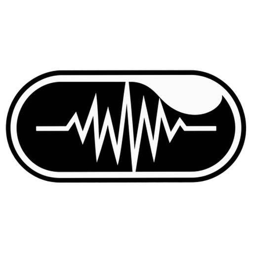

<div align="center">



# OPENFLOW

### Zero-Limit · 100% Offline · Local AI Voice Dictation & Meeting Intelligence for Windows

**Created with precision by Sachidananda**

<br />

[](https://github.com/Sachin1724/OpenFlow)
[](https://github.com/Sachin1724/OpenFlow)
[](https://github.com/Sachin1724/OpenFlow)
[](LICENSE)

<br />

*Dictate directly into any Windows app with sub-150ms latency. Zero cloud dependencies. Zero monthly subscriptions. Complete privacy.*

</div>

---

## Cinematic Product Walkthrough

OpenFlow replaces legacy cloud-tethered dictation services with a standalone, hardware-accelerated local engine built directly on Windows low-level APIs.

```
       [ HOLD CTRL + SHIFT ]
                 │
                 ▼
  ┌─────────────────────────────────┐
  │  ● Live Audio Array AM-C1  ·  EN│  ◄── Smooth Dynamic Island Capsule
  └─────────────────────────────────┘
                 │ (Speak naturally in any application)
                 ▼
       [ RELEASE HOTKEY ]
                 │
                 ├──> CTranslate2 / CUDA fp16 (<150ms transcription)
                 ├──> Intelligent Tone Formatting & Filler Stripping
                 └──> Non-destructive Win32 SendInput Paste into Target HWND
```

---

## Architectural Bento Grid

<table width="100%">
<tr>
<td width="50%" valign="top">

### 01 · Local CUDA & DirectML Engine
Runs entirely on your local hardware. Accelerated via CTranslate2 `float16` kernels on NVIDIA GeForce RTX GPUs, with automatic fallback to DirectML and vectorized AVX2 CPU execution. Audio never traverses a network socket.
- **Latency**: Sub-150ms roundtrip
- **Privacy**: 100% offline, zero cloud calls
- **Cost**: Unlimited words, zero subscriptions

</td>
<td width="50%" valign="top">

### 02 · Dynamic Island Floating Capsule
An always-on-top glassmorphic HUD anchored to your screen. Built with custom PyQt6 drawing paths and non-activating window styles that never steal keyboard focus from active games, editors, or browsers.
- **Morphing**: 360ms OutCubic easing between Capsule, Line, and HUD
- **Stealth Mode**: Sleek 76x8 hairline or auto-hide when idle
- **Live Visualizer**: Real-time RMS audio waveform meters
- **Opacity**: Settings slider from 30% to 100%, applied live

</td>
</tr>
<tr>
<td width="50%" valign="top">

### 03 · Autonomous Meeting Intelligence
Background meeting detection for Google Meet, Zoom, Microsoft Teams, and Webex. Automatically captures spoken discussion, isolates participants, and formats discussions into structured executive notes.
- **Auto-Detection**: Scans active foreground and window titles
- **Structure**: Executive summary, key decisions, action items
- **Storage**: Persistent SQLite ledger with one-click export

</td>
<td width="50%" valign="top">

### 04 · Linguistic & Dialect Optimization
Engineered to resolve phonetic ambiguities in Indic and European languages. Specialized context prompts ensure Hindi and Odia are transcribed into authentic Devanagari and Odia scripts rather than phonetic drift or alternate alphabets.
- **Styles**: Smart Clean, Developer/Code, Email, Bullets, Verbatim
- **Languages**: Auto-Detect (99 languages), English, Hindi, Odia, Spanish, French, German, Japanese, Chinese, Russian, and Portuguese
- **Native Odia**: AI4Bharat IndicConformer (int8, 197 MB) writes real Odia script: 21.7% WER on FLEURS vs 136% for Whisper small, ~280 ms a clip on CPU
- **Odia → English**: speak Odia, get English, through IndicTrans2 (200M, CTranslate2 int8), fully offline
- **Voice Edits** *(optional)*: select text and say "make this formal" or "summarize this"; a local Qwen2.5-1.5B rewrites it in place. The same model writes offline meeting notes

</td>
</tr>
</table>

---

## System Architecture

```
               [ Windows WH_KEYBOARD_LL Global Hook ]
                                 │
                 ┌───────────────┴───────────────┐
                 ▼                               ▼
       [ Push-to-Talk Event ]         [ Meeting Application Active ]
                 │                               │
                 ▼                               ▼
     AudioRecorder (16kHz PCM)       MeetingSession (Dual Stream)
                 │                               │
                 ▼                               ▼
    CTranslate2 Faster-Whisper        CTranslate2 Faster-Whisper
          (CUDA / FP16)                    (Segmented Stream)
                 │                               │
                 ▼                               ▼
      Context-Aware Refiner             Executive Note Structurer
 (Strips fillers, applies tone)    (Agenda, Decisions, Action Items)
                 │                               │
                 ▼                               ▼
       Win32 WindowInjector           Local SQLite Archive
 (Preserves clipboard, Ctrl+V)        (~/.openflow/openflow.db)
```

---

## Hardware Mic Auto-Detection & Live Hotplug

OpenFlow interfaces directly with the Windows `winmm` audio kernel via `waveInGetNumDevs` and `waveInGetDevCapsW`. When you attach or disconnect a microphone:
1. OpenFlow detects the change without restarting the application.
2. Spawns an animated companion pill notifying you of the newly connected device.
3. Automatically switches to the primary active device and recalculates live audio level channels.
4. Filters out inactive Bluetooth artifacts and disconnected hardware aliases.

---

## Keyboard Shortcuts Reference

| Shortcut | Action | Description |
| :--- | :--- | :--- |
| **`Ctrl + Shift`** *(Hold)* | **Push to Talk** | Hold while speaking; release to transcribe and paste immediately |
| **Hotkey tap** *(under 0.35 s)* | **Ignored** | A quick tap or a Ctrl shortcut is discarded, so a mis-press never leaves the capsule recording |
| **Toggle mode** *(Settings)* | **Hands-Free** | Press once to begin continuous dictation; press again to finalize |
| **`Capsule Click`** | **Expand HUD** | Morphs the compact floating capsule into the Apple Control Center HUD |
| **`Double Click Line`** | **Restore Capsule** | Wakes the minimized bar from desktop stealth mode |

---

## Getting Started

### Option 1: Standalone Windows Binary (Recommended)
Download the standalone release package without installing Python or build tools:
1. Download `OpenFlow-v1.0-Windows-x64.zip` from [Releases](https://github.com/Sachin1724/OpenFlow/releases).
2. Extract the archive to any directory (e.g. `C:\OpenFlow`).
3. Launch `OpenFlow.exe` (or use `Launch-OpenFlow.bat`).

### Option 2: Running from Source

#### Prerequisites
- Windows 10 or Windows 11 (64-bit)
- Python 3.10 or higher
- NVIDIA GeForce GPU with CUDA drivers (Optional; CPU fallback is included)

```powershell
# 1. Clone the repository
git clone https://github.com/Sachin1724/OpenFlow.git
cd OpenFlow

# 2. Install dependencies
uv pip install -r requirements.txt --system
# Or with standard pip:
python -m pip install -r requirements.txt

# 3. Launch OpenFlow
python -m openflow.main
```

*To launch silently in the background without a command window, double-click `launch_openflow_silent.vbs`.*

---

## Building the Standalone Executable

OpenFlow includes a one-command build pipeline configured with PyInstaller:

```powershell
# Run the automated build script
python build_exe.py
```

This compiles:
- Standalone portable binary directory at `dist/OpenFlow/OpenFlow.exe`
- Distributable portable archive at `dist/OpenFlow-v1.0-Windows-x64.zip`

---

## File and Package Hierarchy

```
openflow/
├── OpenFlow.spec                 # PyInstaller standalone compilation manifest
├── build_exe.py                  # One-click Windows distribution builder
├── run_app.py                    # Standalone application entry wrapper
├── run_openflow.bat              # Quick developer launcher
├── launch_openflow_silent.vbs    # Background Windows launcher
├── config.py                     # Persistent settings (~/.openflow/config.json)
├── database.py                   # SQLite history & meeting notes store
├── main.py                       # Main process loop, tray coordinator & single instance lock
├── bench_odia.py / research_odia.py  # FLEURS Odia benchmarks behind the landing page
├── engine/
│   ├── audio_recorder.py         # Live Win32 waveIn polling & 16kHz PCM capture
│   ├── transcriber.py            # faster-whisper CUDA/CPU inference engine
│   ├── indic_asr.py              # Odia IndicConformer CTC on ONNX Runtime
│   ├── translator.py             # Odia → English with IndicTrans2 (CTranslate2)
│   ├── local_llm.py              # Qwen2.5 voice edits & meeting notes (CTranslate2)
│   ├── formatter.py              # Filler stripper, capitalization & tone presets
│   ├── injector.py               # Win32 SendInput non-destructive clipboard injector
│   ├── hotkey_manager.py         # Low-level Windows keyboard listener (WH_KEYBOARD_LL)
│   ├── meeting.py                # Meeting app detector & structured notes formatter
│   ├── model_manager.py          # Background HuggingFace model downloader
│   └── sound_effects.py          # Low-latency system feedback tones
└── ui/
    ├── floating_pill.py          # OutCubic morphing capsule, HUD & visualizer
    ├── main_window.py            # Dashboard (History, Meetings, Vocabulary, Settings)
    └── styles.py                 # Sleek monochrome glassmorphic design system
```

---

## Collaboration & Contribution Guide

OpenFlow is built for the global community. Anyone is welcome to contribute, customize, and extend the engine.

### How to Contribute
1. **Fork the Repository**: Create your personal branch (`git checkout -b feature/amazing-feature`).
2. **Add Custom Tone Presets**: Add new style formatters in [`engine/formatter.py`](engine/formatter.py).
3. **Expand Meeting Support**: Add heuristics for additional collaborative software in [`engine/meeting.py`](engine/meeting.py).
4. **Optimize Dialects**: Expand prompt engineering dictionaries in [`engine/context_detector.py`](engine/context_detector.py).
5. **Submit a Pull Request**: Provide a clear explanation of changes and benchmark results.

---

## License & Attribution

Distributed under the MIT License. See `LICENSE` for more information.

**Architected & Developed by Sachidananda.**
